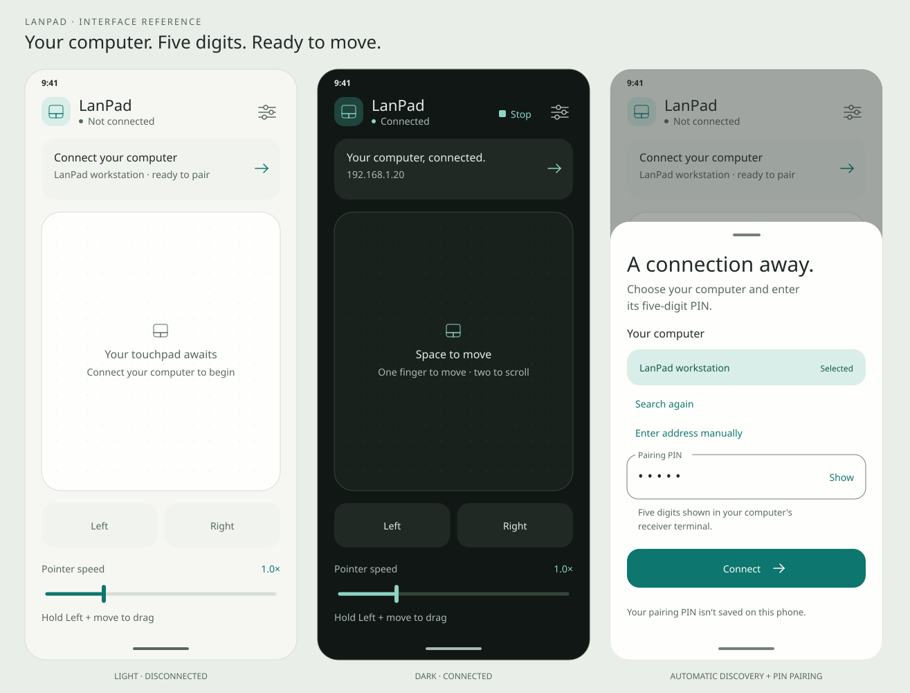
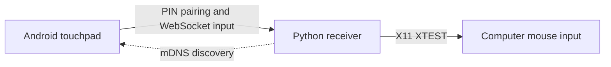

# LanPad

**Your phone. Your touchpad.**

[](android/README.md)
[](receiver/README.md)
[](android/README.md)
[](receiver/README.md)
[](#how-it-works)
[](#next-steps)

Control your Linux desktop with the phone already in your pocket. Swipe, click,
scroll, and drag from a minimal Android touchpad. LanPad finds your computer on
the local network and pairs with a five-digit PIN.

[Get started](#getting-started) · [Preview](#preview) · [How it works](#how-it-works) · [Development](#development)

**Status: early development.** The Android app and Linux/X11 receiver are
implemented. Full build verification, live discovery, and physical-device testing
remain pending. The current transport is unencrypted; use a trusted private network.

## Preview

[](android/design/preview.svg)

Light and dark themes with a muted teal accent. Vector design reference; device
screenshots are pending.

## Features

- One-finger pointer movement and tap to click.
- Two-finger horizontal and vertical scrolling.
- Left and right mouse buttons, with hold-and-drag support.
- Adjustable pointer speed.
- Automatic computer discovery with mDNS/DNS-SD, with manual address fallback.
- Five-digit PIN pairing and one active controller per receiver.
- Connection status, bounded reconnect attempts, and an immediate Stop action.
- Release of held buttons on disconnect, app backgrounding, or receiver shutdown.
- Minimal Material 3 interface with light/dark themes and a muted teal accent.

## How it works



The receiver chooses an active private IPv4 address and advertises its name and
listening port. The app discovers compatible receivers, selects the only result
automatically, or remembers a previously chosen computer. After pairing, touch
gestures become relative movement, button, and scroll commands over a persistent
WebSocket connection.

Both devices need local network access to each other. The computer can use
Ethernet while the phone uses Wi-Fi.

## Requirements

| Component | Requirements |
| --- | --- |
| Computer | Linux with an X11 desktop session, Python 3.12+, and `iproute2` |
| Phone | Android 6.0+ (`minSdk 23`); the app targets Android 16 (`targetSdk 36`) |
| Android build | JDK 17+ (Java 21 supported), Android SDK Platform 36, Build-Tools 36.0.0, and Platform-Tools |
| Network | A shared private IPv4 network; local multicast for automatic discovery |

The initial receiver target is Arch Linux with X11 and i3. Wayland, Windows, and
macOS input adapters are not implemented. Compatibility across Android versions
still needs device testing. Android Studio is optional; the project supplies a
Gradle wrapper and a Linux SDK installer.

## Getting started

Run these commands from the repository root.

### 1. Install and start the receiver

```bash
python3 -m venv receiver/.venv
receiver/.venv/bin/python -m pip install -e ./receiver
receiver/.venv/bin/lanpad --dry-run
```

Keep this terminal open. The receiver prints its address and a five-digit PIN.
`--dry-run` logs input without moving the mouse. Once pairing and gestures work,
stop it with Ctrl+C and run `receiver/.venv/bin/lanpad` to control the real cursor
inside your X11 session.

### 2. Build and install the Android app

In another terminal, from the repository root:

```bash
./android/install-sdk.sh
(cd android && ./gradlew :app:testDebugUnitTest :app:assembleDebug :app:lintDebug)
```

The installer requires Linux x86_64, Java 21, `curl`, `unzip`, `sha256sum`, and
internet access. It installs the SDK in `.android-sdk/` by default and creates
`android/local.properties`. Answer the SDK license prompts. For an existing SDK
or Android Studio setup, see the [Android build guide](android/README.md).

Enable USB debugging on the phone, connect it, and accept the authorization prompt.
Then install the debug APK:

```bash
export PATH="${ANDROID_HOME:-$PWD/.android-sdk}/platform-tools:$PATH"
adb devices
adb install -r android/app/build/outputs/apk/debug/app-debug.apk
```

### 3. Pair and use the touchpad

Open LanPad and tap **Connect your computer**. Choose your computer if several
appear, enter its **Pairing PIN**, and tap **Connect**. No IP or port entry is
normally needed. Keep any leading zeros in the PIN.

Move one finger to control the pointer, tap to left-click, and use two fingers to
scroll. Hold **Left** while moving another finger to drag. Adjust **Pointer speed**
as needed; tap **Stop** to disconnect.

The PIN changes each time the receiver starts and is never saved on the phone.
Five failed pairing attempts within 60 seconds temporarily block new pairing;
wait one minute before retrying. Keep the app and receiver updated together:
both currently use [protocol v2](docs/PROTOCOL.md).

## Connection troubleshooting

- **No computer appears:** keep the receiver running and tap **Search again**.
  Guest Wi-Fi or client isolation can prevent devices from communicating.
- **Discovery is blocked:** select **Enter address manually** and use the address
  and port printed by the receiver.
- **The PC has several networks:** start the receiver with `--interface wlan0`,
  replacing `wlan0` with your LAN interface. `--host` also accepts an explicit
  private IPv4 address.
- **A firewall is active:** allow local UDP 5353 for mDNS and TCP 8765 for control
  from the intended private subnet. `--port` changes the control port and its
  advertisement; `--no-discovery` disables mDNS.

The receiver does not change firewall settings. See the
[receiver guide](receiver/README.md) for local input and terminal-client checks.

## Development

Install receiver development dependencies, then run its checks:

```bash
receiver/.venv/bin/python -m pip install -e './receiver[dev]'
receiver/.venv/bin/python -m pytest -q receiver/tests
receiver/.venv/bin/ruff check receiver
```

Run Android tests, build the APK, and check lint:

```bash
(cd android && ./gradlew :app:testDebugUnitTest :app:assembleDebug :app:lintDebug)
```

With an authorized phone or emulator connected, run the Compose UI tests:

```bash
(cd android && ./gradlew :app:connectedDebugAndroidTest)
```

Validation so far: 91 receiver tests and 16 Android JVM tests passed. Three
receiver WebSocket tests were skipped because sockets were unavailable. All
Android Kotlin sources, including Compose and device test sources, compiled
against the Android SDK API. The full Gradle build, Android WebSocket tests,
lint, and live phone control still need verification outside the restricted
development environment.

## Project structure

| Path | Purpose |
| --- | --- |
| [`android/`](android/README.md) | Kotlin/Compose application, discovery, WebSocket client, gestures, and tests |
| [`receiver/`](receiver/README.md) | Python asyncio server, discovery, X11 adapter, terminal client, and tests |
| [`docs/PROTOCOL.md`](docs/PROTOCOL.md) | Pairing, input messages, discovery metadata, and connection limits |
| [`android/design/preview.svg`](android/design/preview.svg) | Vector UI design reference, including manual connection setup |

## Next steps

- Verify discovery, dragging, scrolling, and reconnection on physical devices.
- Test older Android versions and tune gesture responsiveness.
- Add encrypted transport with verified receiver identity before regular use.
- Package releases and add receiver tray controls and QR pairing.
- Add input adapters for other desktop environments and operating systems.
