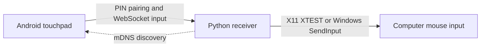

# LanPad

**Your phone. Your touchpad.**

[](android/README.md)
[](receiver/README.md)
[](receiver/README.md)
[](android/README.md)
[](receiver/README.md)
[](#how-it-works)
[](#next-steps)

Control your Linux/X11 or Windows desktop with the phone already in your pocket. Swipe, click,
scroll, drag, type text, and send shortcuts from an Android remote control. LanPad finds your computer on
the local network and pairs with a five-digit PIN.

[Get started](#getting-started) · [Preview](#preview) · [How it works](#how-it-works) · [Development](#development)

**Status: early development.** The Android app and Linux/X11 and Windows receivers are
implemented. Full build verification, live discovery, and physical-device testing
remain pending. The current transport is unencrypted; use a trusted private network.

## Preview

[](android/design/preview.svg)

Light and dark themes, automatic computer discovery, and five-digit PIN pairing.
Vector design reference; device screenshots are pending. Android Studio's
**PIN pairing · light** and **PIN pairing · dark** previews render the actual
pairing components in `LanPadScreen.kt`.

## Features

- One-finger pointer movement and tap to click.
- Two-finger horizontal and vertical scrolling.
- Left and right mouse buttons, with hold-and-drag support.
- Adjustable pointer speed.
- Mouse/keyboard icon switch, Unicode text composer, navigation and function keys.
- Persistent Ctrl/Alt/Shift/Super selections and common editing actions.
- Personal i3 shortcuts for apps, workspaces, windows, layouts, resizing, and media.
- Automatic computer discovery with mDNS/DNS-SD, with manual address fallback.
- First-use PIN pairing, remembered phones with Keystore signing keys, and one active controller.
- Connection status, bounded reconnect attempts, and an immediate Stop action.
- Release of held buttons on disconnect, app backgrounding, or receiver shutdown.
- Minimal Material 3 interface with light/dark themes and a muted teal accent.

## How it works



The receiver chooses an active private IPv4 address and advertises its name and
listening port. The app discovers compatible receivers, selects the only result
automatically, or remembers a previously chosen computer. After pairing, touch
gestures become relative movement, button, and scroll commands over a persistent
WebSocket connection.

Both devices need local network access to each other. The computer can use
Ethernet while the phone uses Wi-Fi.

## Requirements

| Component | Requirements |
| --- | --- |
| Computer | Python 3.12+; Linux with X11 and `iproute2`, or Windows 10/11 with Windows PowerShell |
| Phone | Android 6.0+ (`minSdk 23`); the app targets Android 16 (`targetSdk 36`) |
| Android build | JDK 17+ (Java 21 supported), Android SDK Platform 36, Build-Tools 36.0.0, and Platform-Tools |
| Network | A shared private IPv4 network; local multicast for automatic discovery |

The original receiver target is Arch Linux with X11 and i3; a native Windows
mouse adapter is also provided. Wayland and macOS input adapters are not implemented.
Native Windows cursor control and discovery still need physical-device testing.
Compatibility across Android versions
still needs device testing. Android Studio is optional; the project supplies a
Gradle wrapper and a Linux SDK installer.

## Getting started

Run these commands from the repository root.

### 1. Install and start the receiver

On Linux:

```bash
python3 -m venv receiver/.venv
receiver/.venv/bin/python -m pip install -e ./receiver
receiver/.venv/bin/lanpad --dry-run
```

Keep this terminal open. The receiver prints its address and a five-digit PIN.
`--dry-run` logs input without moving the mouse. Once pairing and gestures work,
stop it with Ctrl+C and run `receiver/.venv/bin/lanpad` to control the real cursor
inside your X11 session.

On Windows, use PowerShell with Python 3.12 or newer installed:

```powershell
py -3 -m venv receiver\.venv
.\receiver\.venv\Scripts\python.exe -m pip install -e ./receiver
.\receiver\.venv\Scripts\lanpad.exe --dry-run
```

After testing pairing, stop with Ctrl+C and run
`.\receiver\.venv\Scripts\lanpad.exe` for native mouse control. No X11, WSL,
administrator session or extra input driver is required. Allow Python on the
**Private** network if Windows Firewall prompts you. Input is limited to your
interactive desktop; Windows blocks control of elevated applications and UAC
or secure desktops from an ordinary process. See the [receiver guide](receiver/README.md).

### 2. Build and install the Android app

In another terminal, from the repository root:

```bash
./android/install-sdk.sh
(cd android && ./gradlew :app:testDebugUnitTest :app:assembleDebug :app:lintDebug)
```

The installer requires Linux x86_64, Java 21, `curl`, `unzip`, `sha256sum`, and
internet access. It installs the SDK in `.android-sdk/` by default and creates
`android/local.properties`. Answer the SDK license prompts. For an existing SDK
or Android Studio setup, see the [Android build guide](android/README.md).

Enable USB debugging on the phone, connect it, and accept the authorization prompt.
Then install the debug APK:

```bash
export PATH="${ANDROID_HOME:-$PWD/.android-sdk}/platform-tools:$PATH"
adb devices
adb install -r android/app/build/outputs/apk/debug/app-debug.apk
```

### 3. Pair and use the touchpad

Open LanPad and tap **Connect your computer**. Choose your computer if several
appear, enter its **Pairing PIN**, and tap **Connect**. No IP or port entry is
normally needed. Keep any leading zeros in the PIN.

Move one finger to control the pointer, tap to left-click, and use two fingers to
scroll. Hold **Left** while moving another finger to drag. Adjust **Pointer speed**
as needed; tap **Stop** to disconnect.

Tap the **keyboard icon** beside the connection status to switch modes. In
**Type & keys**, compose text and tap **Send text**; **Enter ↵** is a separate
action, so sending a single-line shell command does not execute it automatically.
Newlines explicitly included in text are sent. Modifier chips stay selected until toggled off or cleared; each key tap still
presses and releases a complete chord. Disconnecting clears selections. Use **Show letters & numbers** for combinations such as Ctrl+R.
Tap the touchpad icon to return to mouse mode.

**i3 shortcuts** embeds the bindings from your i3 configuration, with Super as
Mod4. Categories cover Apps, Windows, Layout, Media, Session, and Workspaces.
Workspace 10 sends Super+0; **Move window to** adds Shift. In Layout, enter
**Resize mode**, adjust with its plain arrow controls, and tap **Done ↵** or
**Escape** to exit. Bindings are a static snapshot in
`android/app/src/main/java/dev/lanpad/input/Shortcuts.kt`; changing the desktop
config does not automatically update the app. These controls require i3.

Update the receiver alongside this app: keyboard support uses protocol v4.
On Linux, text, mouse control, and key chords use XTEST directly; no
`xdotool` installation is required. Windows text and keys use native SendInput (mic mute and brightness
keys are Linux-only).

The PIN changes each time the receiver starts and is never saved on the phone.
With **Remember this phone** enabled, first-time pairing registers the phone's
Keystore public key. Later connections hide the PIN field and offer **Reconnect**; trust survives
app/receiver restarts and expires after 90 days. Connection settings show the connected computer and
**Auto-connect valid for N days**, updated from the receiver on each connection.
The countdown does not extend the original expiry. **Pair again with a PIN**
re-pairs the device and renews trust. Use **Forget saved computers on this phone** to clear local
mappings; to revoke phones on the receiver, stop it, run `lanpad --forget-devices`,
and restart. See the [security assessment](docs/SECURITY.md): remembered pairing
prevents captured-proof replay, but input transport still requires a trusted LAN.
Five failed pairing attempts within 60 seconds temporarily block new pairing;
wait one minute before retrying. Keep the app and receiver updated together:
both currently use [protocol v4](docs/PROTOCOL.md).

## Connection troubleshooting

- **No computer appears:** keep the receiver running and tap **Search again**.
  Guest Wi-Fi or client isolation can prevent devices from communicating.
- **Discovery is blocked:** select **Enter address manually** and use the address
  and port printed by the receiver.
- **The PC has several networks:** start the receiver with `--interface wlan0`
  on Linux or `--interface "Wi-Fi"` on Windows, replacing the name with your LAN
  interface alias. `--host` also accepts an explicit
  private IPv4 address.
- **A firewall is active:** allow local UDP 5353 for mDNS and TCP 8765 for control
  from the intended private subnet. `--port` changes the control port and its
  advertisement; `--no-discovery` disables mDNS.
- **Port 8765 is already in use:** start with `--port 8766`; discovery advertises
  the selected port automatically.

The receiver does not change firewall settings. See the
[receiver guide](receiver/README.md) for local input and terminal-client checks.

## Development

Install receiver development dependencies, then run its checks:

```bash
receiver/.venv/bin/python -m pip install -e './receiver[dev]'
receiver/.venv/bin/python -m pytest -q receiver/tests
receiver/.venv/bin/ruff check receiver
```

Run Android tests, build the APK, and check lint:

```bash
(cd android && ./gradlew :app:testDebugUnitTest :app:assembleDebug :app:lintDebug)
```

With an authorized phone or emulator connected, run the Compose UI tests:

```bash
(cd android && ./gradlew :app:connectedDebugAndroidTest)
```

Validation: 164 receiver tests passed on Linux, including real loopback
WebSocket text/shortcut input, remembered-device signature verification, replay
rejection, expiry, revocation and error recovery. The opt-in native Windows test
was skipped. All 20 Android JVM tests and 10 tests on the connected phone passed, including
persistent modifiers, connected/remembered connection UI and Keystore resume.
Debug APK assembly, device test APK assembly, and lint passed (one existing backup
configuration warning). Real X11 testing confirmed accented/emoji key events and restored
keyboard mappings. Android Keystore enrollment and PIN-free reconnection were
verified against a real dry-run Python receiver on the connected phone. See the
[security assessment](docs/SECURITY.md) for plaintext transport limitations.

## Project structure

| Path | Purpose |
| --- | --- |
| [`android/`](android/README.md) | Kotlin/Compose application, discovery, WebSocket client, gestures, and tests |
| [`receiver/`](receiver/README.md) | Python asyncio server, discovery, Linux/X11 and Windows adapters, terminal client, and tests |
| [`docs/PROTOCOL.md`](docs/PROTOCOL.md) | Pairing, input messages, discovery metadata, and connection limits |
| [`android/design/preview.svg`](android/design/preview.svg) | Vector UI design reference, including automatic discovery and PIN pairing |

## Next steps

- Verify discovery, dragging, scrolling, and reconnection on physical devices.
- Test older Android versions and tune gesture responsiveness.
- Add encrypted transport with verified receiver identity before regular use.
- Package releases and add receiver tray controls and QR pairing.
- Add input adapters for other desktop environments and operating systems.
