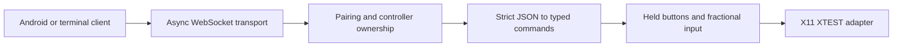

# Desktop receiver

A terminal application for Linux with X11. It supports movement, left/right/middle
clicks, dragging, and horizontal/vertical scrolling. Run it as your desktop user
inside the X11 session. A GUI or tray icon is planned.

## Install

From the project root, with Python 3.12 or newer:

```bash
cd receiver
python3 -m venv .venv
.venv/bin/python -m pip install -e '.[dev]'
```

Runtime dependencies are `websockets`, `python-xlib`, and `zeroconf`. Linux's
`iproute2` supplies interface information for automatic address selection.
A virtual environment keeps project dependencies separate from system Python.
No Android SDK
or JDK is needed for the receiver.

## Local input check

Start with logging only:

```bash
.venv/bin/lanpad local --dry-run
```

Enter one command per line:

```json
{"type":"move","dx":40,"dy":20}
{"type":"move","dx":-40,"dy":-20}
{"type":"click","button":"left"}
{"type":"click","button":"right"}
{"type":"scroll","dx":0,"dy":1}
{"type":"scroll","dx":1,"dy":0}
{"type":"button","button":"left","down":true}
{"type":"release_all"}
```

Ctrl+D ends the test. Repeat with `.venv/bin/lanpad local` for real cursor input.
Place the cursor over a disposable test window before clicking or scrolling.
The program applies each command immediately; if testing a held button, Ctrl+D
or Ctrl+C releases it. Check both scroll directions and both button clicks.

## WebSocket check

In one terminal:

```bash
.venv/bin/lanpad --host 127.0.0.1 --dry-run
```

In a second terminal, from `receiver/`:

```bash
.venv/bin/lanpad-client
```

Enter the printed five-digit PIN when prompted, then use the same JSON
commands as above. The client sends heartbeats every second while waiting for
terminal input. Ctrl+D sends release-all and disconnects; Ctrl+C disconnects and
the receiver releases held buttons.

Repeat with a wrong PIN: pairing must fail without applying any input.
Start a second client with the correct PIN while the first remains paired:
it must be rejected and leave the first client's drag untouched. Hold a button
and disconnect the first client, then check that the button is released and
another client can pair. Repeat without `--dry-run` for real cursor input.

For abrupt-disconnect checks, terminate the client process while dragging or
interrupt its network access. The receiver releases buttons as soon as the
disconnect is detected, or within the five-second application heartbeat timeout.
Stop the receiver with Ctrl+C while holding a button and verify release.

## Private LAN testing

Start without an address:

```bash
.venv/bin/lanpad
```

The receiver selects an active private IPv4 address, preferring the default-route
LAN interface and ignoring common VPN/container interfaces. It advertises its
name, address, and listening port with mDNS. Open the Android app, select your
computer if several appear, and enter the printed PIN. Neither side needs a
manually entered IP address. Use `--dry-run` to log gestures first.

Use `--interface wlan0` to choose a network by interface name, or `--host` for an
explicit address. A subnet without a default gateway uses the first eligible
LAN interface. `--port` changes the advertised control port. If discovery is
unavailable, use the app's **Enter address manually** option and the address and
port printed by the receiver. `--no-discovery` runs without mDNS publication.
The terminal client also accepts `--url ws://<printed-address>:<port>`.

The phone and computer need network reachability; guest Wi-Fi isolation may
prevent it. If the computer has a firewall, allow TCP 8765 (or your chosen port)
and local mDNS UDP 5353 from the intended private subnet. The receiver does not
modify firewall settings. Automatic discovery currently uses IPv4.

Transport is unencrypted in this development version. Verified encryption is
still required before regular use. PINs change on every restart. Five failed
pairing attempts in 60 seconds temporarily block new pairing across all clients;
wait one minute before trying again. Update both endpoints for protocol v2.

## Design



| Component | Responsibility |
| --- | --- |
| `protocol.py` | Validate exact message schemas and produce immutable typed commands |
| `receiver.py` | Authenticate, own one controller, enforce time/rate limits, release on exit |
| `mouse.py` | Track held buttons, preserve drags, accumulate fractional input |
| `adapters.py` | Inject relative input through XTEST or log it for dry runs |
| `server.py` | Run the modern asyncio WebSocket API and handle process shutdown |
| `discovery.py` | Select a LAN interface and publish/withdraw its DNS-SD service |
| `cli.py` | Wire the receiver together and expose the local input test |
| `client.py` | Pair, send terminal commands, maintain heartbeats, and detect closure |

One asyncio event loop owns receiver state, so ownership changes require no
locks. X11 calls enqueue small bounded requests and flush them on that same
loop; no worker thread can apply old movement after cleanup. The input adapter
interface allows later operating systems to reuse validation and mouse state.
There is no extra HTTP framework or validation dependency.

Relative XTEST movement is performed directly, avoiding repeated pointer
position queries. Gesture recognition, sensitivity, and smoothing belong to the
phone app; the receiver applies the phone's requested deltas.

The transport uses the [current websockets asyncio API](https://websockets.readthedocs.io/en/stable/reference/asyncio/server.html).
Relative motion and button events follow the [XTEST protocol](https://xorg.freedesktop.org/archive/X11R7.7/doc/xextproto/xtest.html).
See the [wire protocol](../docs/PROTOCOL.md) for the Android app's contract.

## Automated checks

```bash
.venv/bin/python -m pytest -q
.venv/bin/ruff check .
```

Tests exercise pairing, invalid input, single-controller ownership, mouse
state, PIN attempt limits, interface selection, discovery lifecycle, failure
cleanup, timeouts, floods, and X11 event translation without moving your cursor.
`test_websocket.py` additionally uses actual loopback
WebSocket connections when dependencies and socket access are available. It
skips when those requirements are unavailable.

The latest restricted-environment run passed 91 tests and skipped three live
WebSocket tests because sockets were unavailable. Live discovery, WebSocket, and
physical cursor verification remain pending. Run the checks above and the local
and WebSocket input checks in your desktop session before relying on mouse control.
