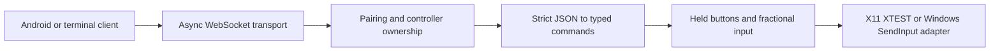

# Desktop receiver

A terminal application for Linux with X11 and Windows 10/11. It supports movement, left/right/middle
clicks, dragging, and horizontal/vertical scrolling. Run it as your desktop user
inside the X11 session on Linux, or as your signed-in desktop user on Windows.
A GUI or tray icon is planned.

## Install

From the project root, with Python 3.12 or newer. On Linux:

```bash
cd receiver
python3 -m venv .venv
.venv/bin/python -m pip install -e '.[dev]'
```

On Windows, in PowerShell:

```powershell
cd receiver
py -3 -m venv .venv
.\.venv\Scripts\python.exe -m pip install -e '.[dev]'
.\.venv\Scripts\lanpad.exe --dry-run
```

Use the executable paths directly; virtual-environment activation and execution-policy
changes are unnecessary. For real cursor input, stop the dry run with Ctrl+C and run
`.\.venv\Scripts\lanpad.exe`. `--port 8766` avoids a conflict with another app on 8765.

Runtime dependencies are `websockets`, `zeroconf`, and, on Linux only, `python-xlib`. Linux's
`iproute2` supplies interface information for automatic address selection.
A virtual environment keeps project dependencies separate from system Python.
No Android SDK
or JDK is needed for the receiver.

Windows uses native `SendInput` through Python's standard-library `ctypes`, with
no WSL, X server, mouse driver or administrator privileges required. Use the same
interactive desktop as the applications you want to control. Windows' UIPI can
block injection into elevated applications; UAC prompts, locked sessions and other
secure desktops cannot be controlled by this receiver. Do not expect mouse control
of applications with a higher integrity level than the receiver.

## Local input check

Start with logging only:

```bash
.venv/bin/lanpad local --dry-run
```

Enter one command per line:

```json
{"type":"move","dx":40,"dy":20}
{"type":"move","dx":-40,"dy":-20}
{"type":"click","button":"left"}
{"type":"click","button":"right"}
{"type":"scroll","dx":0,"dy":1}
{"type":"scroll","dx":1,"dy":0}
{"type":"button","button":"left","down":true}
{"type":"release_all"}
```

On Windows use `.\.venv\Scripts\lanpad.exe local --dry-run`, then
`.\.venv\Scripts\lanpad.exe local` for real input; Ctrl+Z followed by Enter ends
terminal input. On Linux, Ctrl+D ends the test. Repeat with `.venv/bin/lanpad local` for real cursor input.
Place the cursor over a disposable test window before clicking or scrolling.
The program applies each command immediately; if testing a held button, Ctrl+D
or Ctrl+C releases it. Check both scroll directions and both button clicks.

## WebSocket check

The interactive `lanpad-client` currently uses Unix terminal pipes and is Linux-only.
On Windows, check local input with the commands above and test pairing and network
input with the Android app. The WebSocket server itself supports both platforms.

In one terminal:

```bash
.venv/bin/lanpad --host 127.0.0.1 --dry-run
```

In a second terminal, from `receiver/`:

```bash
.venv/bin/lanpad-client
```

Enter the printed five-digit PIN when prompted, then use the same JSON
commands as above. The client sends heartbeats every second while waiting for
terminal input. Ctrl+D sends release-all and disconnects; Ctrl+C disconnects and
the receiver releases held buttons.

Repeat with a wrong PIN: pairing must fail without applying any input.
Start a second client with the correct PIN while the first remains paired:
it must be rejected and leave the first client's drag untouched. Hold a button
and disconnect the first client, then check that the button is released and
another client can pair. Repeat without `--dry-run` for real cursor input.

For abrupt-disconnect checks, terminate the client process while dragging or
interrupt its network access. The receiver releases buttons as soon as the
disconnect is detected, or within the five-second application heartbeat timeout.
Stop the receiver with Ctrl+C while holding a button and verify release.

## Private LAN testing

Start without an address:

```bash
.venv/bin/lanpad
```

The receiver selects an active private IPv4 address, preferring the default-route
LAN interface and ignoring common VPN/container interfaces. It advertises its
name, address, and listening port with mDNS. Open the Android app, select your
computer if several appear, and enter the printed PIN. Neither side needs a
manually entered IP address. Use `--dry-run` to log gestures first.

Use `--interface wlan0` on Linux or `--interface "Wi-Fi"` on Windows to choose a
network by interface name/alias, or `--host` for an
explicit address. A subnet without a default gateway uses the first eligible
LAN interface. `--port` changes the advertised control port. If discovery is
unavailable, use the app's **Enter address manually** option and the address and
port printed by the receiver. `--no-discovery` runs without mDNS publication.
The terminal client also accepts `--url ws://<printed-address>:<port>`.

The phone and computer need network reachability; guest Wi-Fi isolation may
prevent it. If the computer has a firewall, allow TCP 8765 (or your chosen port)
and local mDNS UDP 5353 from the intended private subnet. The receiver does not
modify firewall settings. Automatic discovery currently uses IPv4.

Windows reads adapter addresses and route metrics using built-in Windows PowerShell,
prefers the active default-route LAN adapter and ignores virtual adapters by default.
An explicit `--interface` can select a virtual adapter if needed. If PowerShell is
unavailable, use `--host` with your private LAN address. Allow Python on the
**Private** profile if Windows Firewall asks; avoid exposing the receiver on a public network.

Transport is unencrypted in this development version. Verified encryption is
still required before regular use. PINs change on every restart. Five failed
pairing attempts in 60 seconds temporarily block new pairing across all clients;
wait one minute before trying again. Update both endpoints for protocol v2.

## Design



| Component | Responsibility |
| --- | --- |
| `protocol.py` | Validate exact message schemas and produce immutable typed commands |
| `receiver.py` | Authenticate, own one controller, enforce time/rate limits, release on exit |
| `mouse.py` | Track held buttons, preserve drags, accumulate fractional input |
| `adapters.py` | Inject relative input through XTEST or log it for dry runs |
| `windows.py` | Translate mouse events to native Windows SendInput with correct ctypes ABI |
| `server.py` | Run the modern asyncio WebSocket API and handle process shutdown |
| `discovery.py` | Select a LAN interface and publish/withdraw its DNS-SD service |
| `cli.py` | Wire the receiver together and expose the local input test |
| `client.py` | Pair, send terminal commands, maintain heartbeats, and detect closure |

One asyncio event loop owns receiver state, so ownership changes require no
locks. X11 calls enqueue small bounded requests and flush them on that same
loop; no worker thread can apply old movement after cleanup. The same validation
and mouse state are reused by the Windows input adapter.
There is no extra HTTP framework or validation dependency.

Relative XTEST movement is performed directly, avoiding repeated pointer
position queries. Gesture recognition, sensitivity, and smoothing belong to the
phone app; the receiver applies the phone's requested deltas.

The transport uses the [current websockets asyncio API](https://websockets.readthedocs.io/en/stable/reference/asyncio/server.html).
Relative motion and button events follow the [XTEST protocol](https://xorg.freedesktop.org/archive/X11R7.7/doc/xextproto/xtest.html).
Windows injection follows [SendInput](https://learn.microsoft.com/en-us/windows/win32/api/winuser/nf-winuser-sendinput)
and [MOUSEINPUT](https://learn.microsoft.com/en-us/windows/win32/api/winuser/ns-winuser-mouseinput).
The native backend defines the complete INPUT union with fixed-width Win32 fields
and a pointer-sized extra-info field, checks how many events SendInput accepted,
and reports partial or failed injection. Windows pointer speed and acceleration
apply to relative motion; adjust sensitivity in the phone app if necessary.
See the [wire protocol](../docs/PROTOCOL.md) for the Android app's contract.

## Automated checks

```bash
.venv/bin/python -m pytest -q
.venv/bin/ruff check .
```

On Windows, from `receiver/`:

```powershell
.\.venv\Scripts\python.exe -m pytest -q
.\.venv\Scripts\python.exe -m ruff check .
```

Tests exercise pairing, invalid input, single-controller ownership, mouse
state, PIN attempt limits, interface selection, discovery lifecycle, failure
cleanup, timeouts, floods, X11 event translation, Windows ABI layouts and event
translation, partial SendInput failures, signal restoration, and cancellation
cleanup without moving your cursor.
`test_websocket.py` additionally uses actual loopback
WebSocket connections when dependencies and socket access are available. It
skips when those requirements are unavailable.

The latest Linux run passed 135 tests, including all three real loopback WebSocket
checks after local socket access was authorized. The native Windows test was
skipped; mocked Windows tests do not establish that cursor injection works in a
real desktop session. CI is configured for Linux and Windows on Python 3.12 and 3.14.
Live discovery and physical cursor verification remain pending.

To opt into the native Windows ABI smoke test from an interactive Windows desktop:

```powershell
$env:LANPAD_WIN_LIVE = '1'
.\.venv\Scripts\python.exe -m pytest -q tests/test_windows.py
Remove-Item Env:LANPAD_WIN_LIVE
```

The native test sends a zero-distance move and checks that an incorrect INPUT size
is rejected. Still run the local input check and Android pairing/dragging/scrolling
checks in your desktop session before relying on mouse control. Force-killing the
receiver skips normal cleanup; use Ctrl+C to release held buttons.
